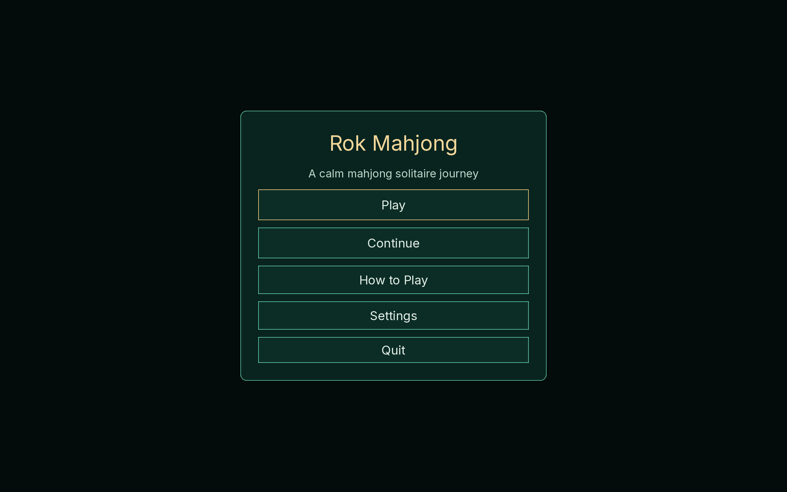
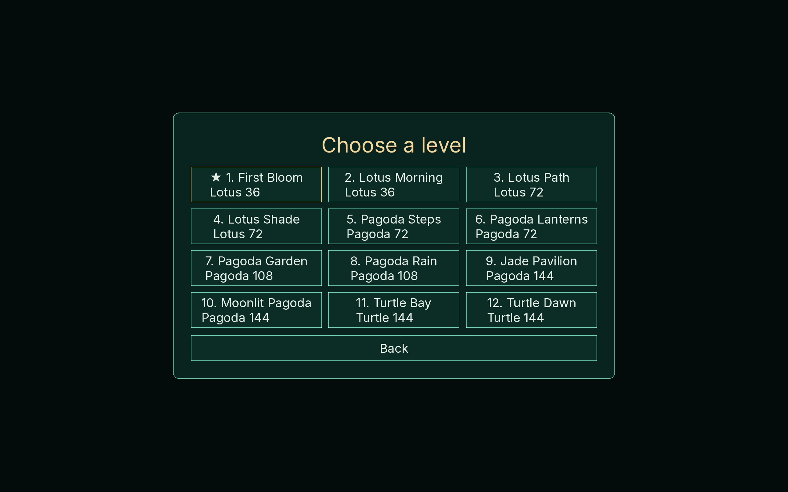
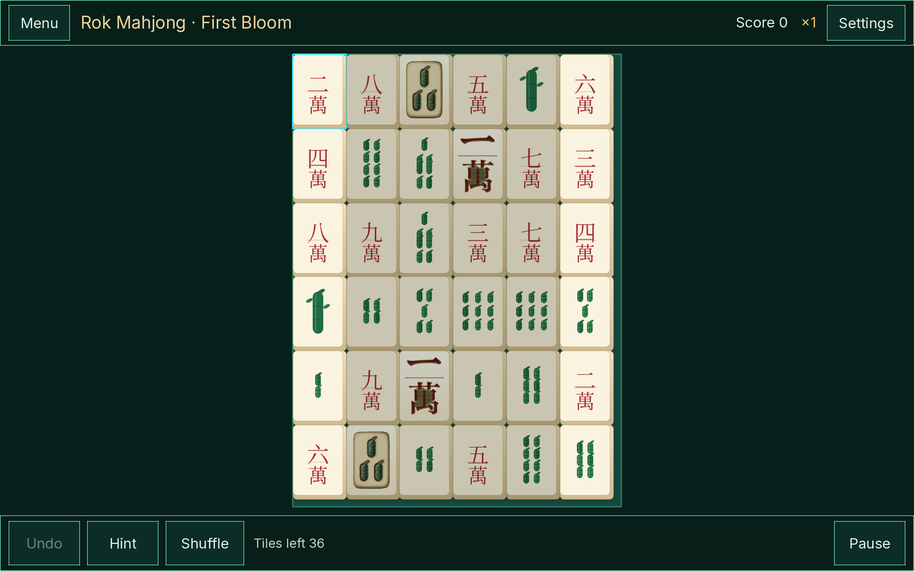
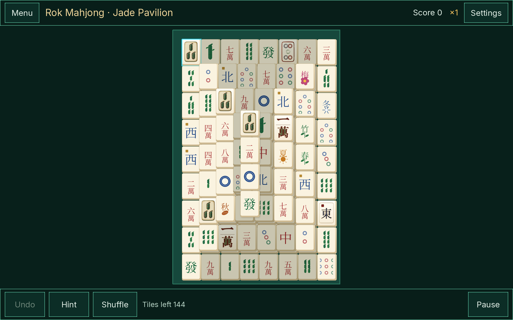

# Rok Mahjong

A relaxing mahjong solitaire matching game built with the
[`zigrok/MonoGame`](https://github.com/zigrok/MonoGame) fork and the
[`zigrok/Forma`](https://github.com/zigrok/Forma) UI toolkit.

The game uses a 2D presentation with 2.5D tiles, supports portrait and landscape
layouts, and is designed for mouse, touch, keyboard and controller from the
start. Desktop is the first target; native mobile is a later Forma workstream.

**Status:** desktop v1 is playable. The 12-level journey, hint/undo/shuffle,
mouse/touch/keyboard/gamepad input, save/resume and headless gameplay suite are
implemented. See [`docs/plan.md`](docs/plan.md) for the live checklist and the
post-v1 backlog.









## Play

```bash
make build
make run
make watch LEVEL=1   # watch the solver play a level in a real window
```

Mouse: click or drag matching tiles. Keyboard: arrows/Tab to move, Enter to
select, H hint, S shuffle, U undo, Esc pause. Gamepad: D-pad/left stick, A
select, B back, X hint, Y shuffle, LB undo, Start pause. Touch uses the same
pointer path as the mouse.

**Initial dependency baseline:** MonoGame `260e930`, Forma `8827393`, XamlX
`0337e9b`. The pinned Forma core and `Forma.Xaml.Build` compile cleanly against
the pinned MonoGame `DesktopGL` project.

## Requirements

- .NET SDK **10.0.100 or newer** (see `global.json`)
- Git 2.40+
- Desktop OpenGL-capable machine for the default `DesktopGL` build
- Optional: [GitHub CLI](https://cli.github.com/) (`gh`) for the submodule PR
  workflow
- Optional: native MonoGame backend toolchains (Metal/Vulkan/DX12) only when
  building those backends

## Checkout

The MonoGame and Forma dependencies are Git submodules. Do **not** use
`--recurse-submodules`: MonoGame contains many native backend submodules that are
only needed for specific builds.

```bash
git clone https://github.com/zigrok/RokMahjong.git
cd RokMahjong

# Required: the game framework and the UI toolkit.
git submodule update --init third_party/MonoGame third_party/Forma

# Required by Forma's compiled FHTML/XAML pipeline.
git -C third_party/Forma submodule update --init external/XamlX
```

Optional runtime SVG icons (only if the bitmap icon atlas is not enough):

```bash
git -C third_party/Forma submodule update --init external/ThorVG
```

Native MonoGame backends initialize their own submodules on demand. For example,
the native Vulkan/Metal path needs SDL3, FAudio and SPIRV-Cross; see
`third_party/MonoGame/README.md` and `BACKEND-DEPENDENCIES.md` before building
those targets. The default `DesktopGL` build does not need them.

To inspect the exact dependency revisions:

```bash
git submodule status --recursive
```

## Repository map

| Path | Purpose |
| --- | --- |
| `src/RokMahjong.Core` | Pure C# rules, layouts, deals, history, scoring |
| `src/RokMahjong.Game` | MonoGame + Forma client, board and screens |
| `src/RokMahjong.Desktop` | Desktop executable host |
| `tests/RokMahjong.Core.Tests` | Rules, layouts, solvability, 10k-seed replay |
| `tests/RokMahjong.Game.Tests` | Real input-router gameplay + Forma headless UI |
| `tools/RokMahjong.Playtest` | Headless level solver with JSON output |
| `tools/RokMahjong.TileArtGen` | SkiaSharp generator for reference art and the tile atlas |
| `tools/tile-pipeline` | `roktiles` CLI for AI face generation, history and selection |
| `tools/gallery.sh` | Windowed screenshot smoke check |
| `tools/plan-progress.sh` | Checklist progress reporter |
| `assets/art/` | Tile atlas, body-less references and selected face art |
| `assets/fonts/` | OFL CJK subset used only by the tile generator |
| `docs/` | Plan, architecture, testing strategy, goal prompt and screenshots |
| `AGENTS.md` | Project rules and definition of done for coding agents |
| `third_party/` | Pinned MonoGame and Forma submodules |

## Development

```bash
make submodules         # initialize MonoGame, Forma and XamlX
make build              # build the solution
make run                # launch the desktop game
make test               # core + game tests
make test-all           # whole solution
make test-tiles         # tile pipeline Python tests
make playtest LEVEL=1 DEVICE=mouse
make watch LEVEL=1      # auto-solve a level in a real window
make tiles              # regenerate reference art and the tile atlas
make tilegen ARGS="status"   # tile generation CLI (ComfyUI / OpenRouter)
make gallery            # capture and validate screenshots
make check-submodules   # verify pins are reachable
```

## Plan and goal tracking

`docs/plan.md` is a live checklist (`- [ ]` open, `- [~]` in progress,
`- [x]` done).

```bash
make progress           # overall progress
make progress-desktop   # M0-M5 desktop progress
```

The desktop goal prompt for the installed `/goal` plugin is
[`docs/goal-desktop-v1.md`](docs/goal-desktop-v1.md). Paste the whole block into
the composer and send it; it already starts with `/goal`. Optionally run
`/goal budget 120` first for a larger turn budget. The goal is complete only
when the plan’s M0–M5 phases and the **Desktop v1 acceptance** checklist are
fully checked and the reply includes the build, test, headless gameplay and
gallery evidence.

## Testing

The test strategy is layered:

- **Core and solvability:** pure C# tests prove that every generated deal and
  shuffle carries a verified removal order that replays through the real game
  API. The smoke suite includes a 10,000-seed sweep.
- **Headless UI and gameplay:** `RokMahjong.Game.Tests` drives the real
  `GameInputRouter` and `BoardController` with a scripted input source for all
  12 levels and all four input devices, plus a Forma `HeadlessInput` UI flow
  test. The native MonoGame `desktopheadless` backend is a post-v1 upgrade.
- **Visual and soak:** the desktop host captures deterministic screenshots and
  `make gallery` validates that every screen rendered real pixels.

```bash
make test-all
make playtest LEVEL=12 DEVICE=gamepad
make gallery
```

`RokMahjong.Playtest` prints a JSON result with the level, device, status,
moves and score.
Full details: [`docs/testing.md`](testing.md).

## Tile art

Tiles are drawn as a 2.5D extrusion: the top face is a perfect axis-aligned
rounded rectangle, and the right and bottom sides are a shaded band inside the
same tile footprint. There is no perspective or camera skew. The 42 faces are
AI-generated and chosen through a local-first pipeline. The generator
emits body-less reference art for every face, and `tools/tile-pipeline` sends it
to ComfyUI (Qwen-Image-Edit 2511 for painted tiles, Qwen-Image-Layered for
transparent RGBA glyphs) or an optional OpenRouter image model. Every generation
is kept with its prompt, seed and parameters; selecting one updates the texture
the game ships with. Glyphs carry a height map, so the symbol picks up real
relief shading on the 3D face.

```bash
make tilegen ARGS="doctor"                                # check ComfyUI + references
make tilegen ARGS="generate --face C1 --style porcelain"  # painted tile
make tilegen ARGS="generate --face C1 --provider layered"  # RGBA glyph
make tilegen ARGS="history --face C1"                     # list past generations
make tilegen ARGS="select <generation-id>"                # apply + rebuild atlas
make tilegen ARGS="reset --face C1"                       # back to vector art
make tiles                                                # rebuild atlas only
```

History lives in `artifacts/tile-pipeline/` (gitignored); only the selected
faces and their provenance manifest are committed. See
[`tools/tile-pipeline/README.md`](tools/tile-pipeline/README.md).

## Working on MonoGame or Forma

Changes to either dependency are developed on a **feature branch inside the
submodule**, validated by the upstream repository's CI, merged through a pull
request, and then pinned in this repository with a separate submodule-pointer
commit.

See [`CONTRIBUTING.md`](CONTRIBUTING.md) for the full workflow and helper
scripts.

## Documentation

- [`docs/plan.md`](docs/plan.md) — product, architecture, milestones, risks and live checklist
- [`docs/architecture.md`](docs/architecture.md) — Mermaid architecture diagrams and invariants
- [`docs/testing.md`](docs/testing.md) — test layers, solvability, headless gameplay, replays, CI gates
- [`AGENTS.md`](AGENTS.md) — project rules and definition of done for coding agents
- [`CONTRIBUTING.md`](CONTRIBUTING.md) — submodule branches, PRs, CI gates
- [`docs/goal-desktop-v1.md`](docs/goal-desktop-v1.md) — prompt for the installed `/goal` plugin
