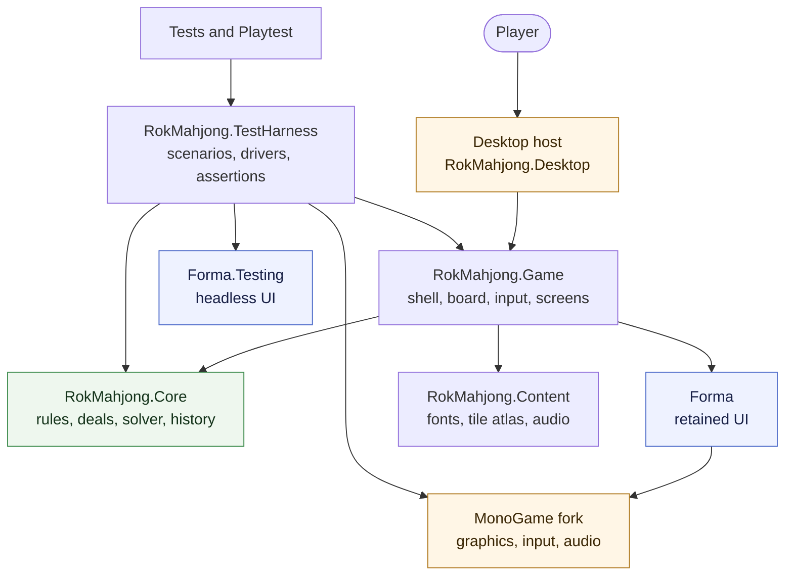
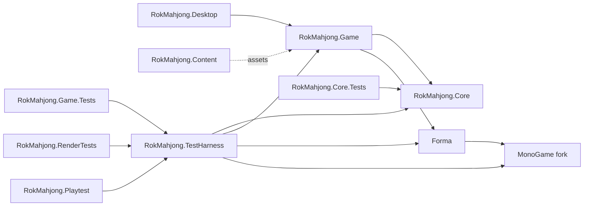
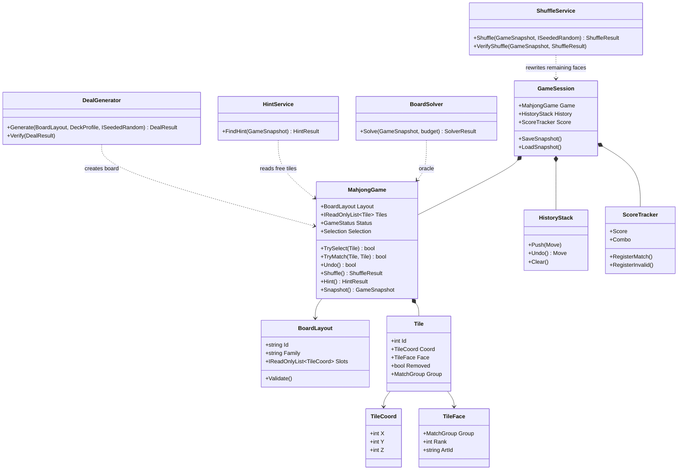
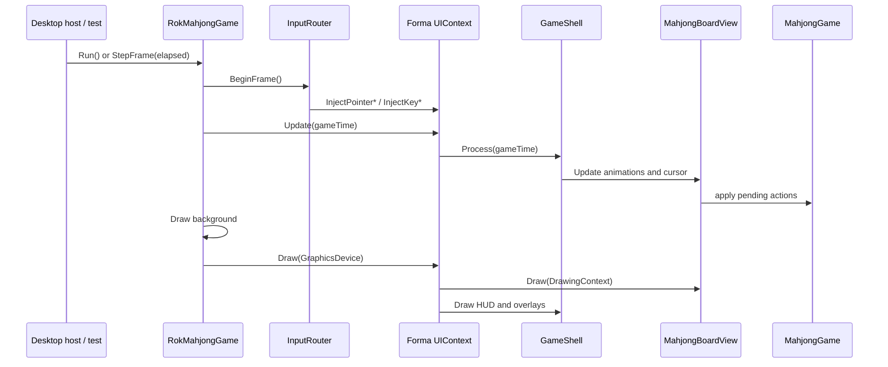
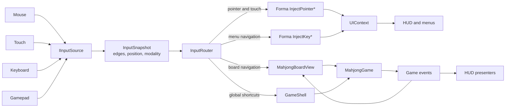
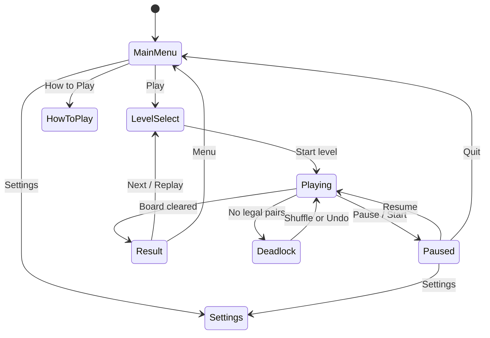
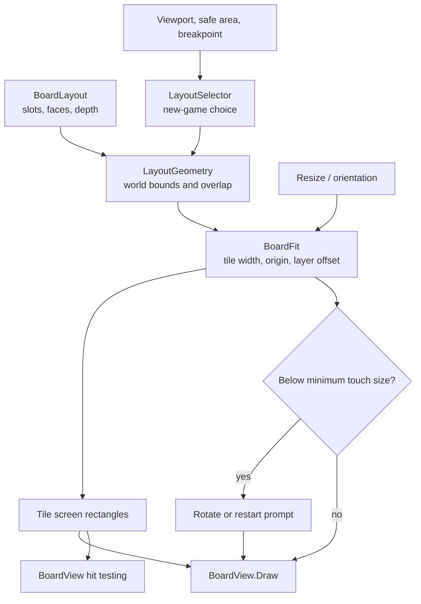
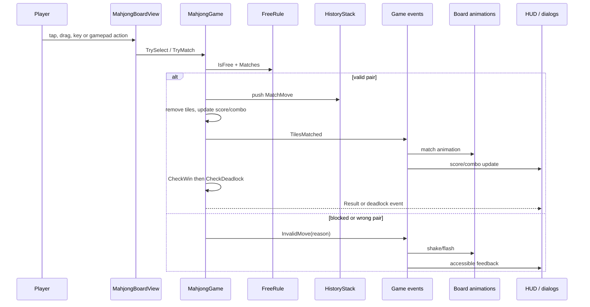
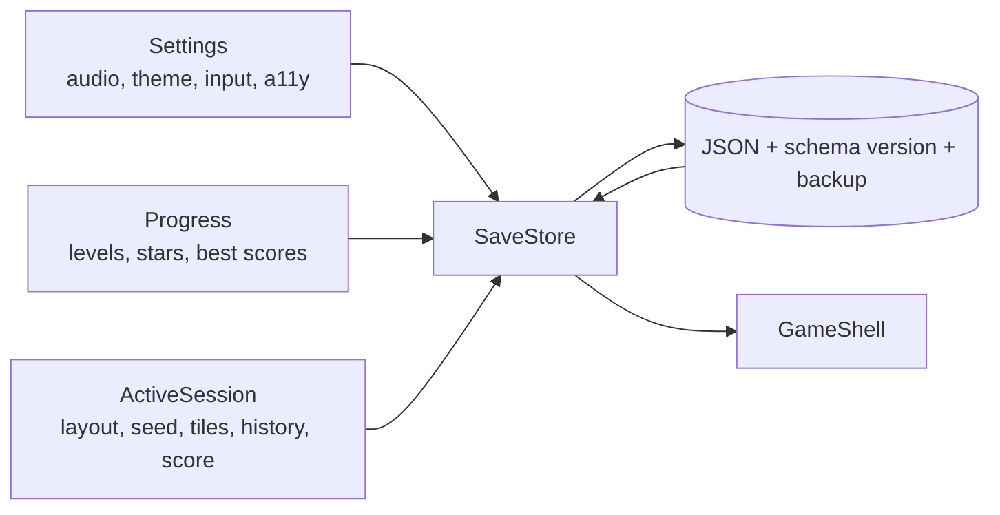
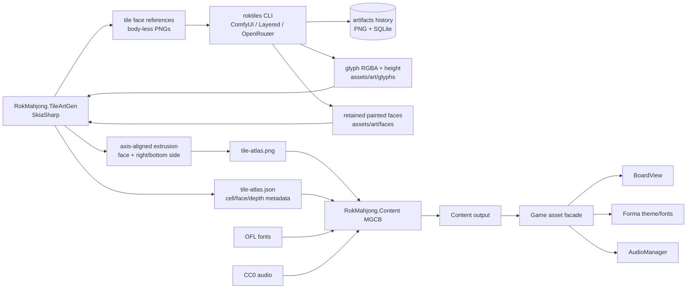

# Architecture

> **Status:** planned, M0. These diagrams describe the intended module boundaries
> and runtime flow. Update them as implementation lands; a diagram that no longer
> matches the code is worse than no diagram.

This document covers the game’s runtime architecture. The automated-testing
architecture lives in [testing.md](testing.md), and the product plan lives in
[plan.md](plan.md).

---

## 1. System context

**Rules of the dependency graph**

- `RokMahjong.Core` is pure C#. It must never reference MonoGame or Forma.
- `RokMahjong.Game` owns presentation, input routing, screens and platform
  services. It may reference Core and Forma.
- `RokMahjong.Desktop` is a thin host. It owns the window, command-line
  arguments and platform-specific lifecycle.
- `RokMahjong.Content` produces runtime assets. Game code consumes them through
  a small asset facade, not through content-project details.
- Tests and the `Playtest` tool drive the real game. They do not fork the rules
  or create a second input path.

---

## 2. Module dependencies

| Project | May reference | Must not reference |
| --- | --- | --- |
| `RokMahjong.Core` | BCL only | MonoGame, Forma, Game, Content |
| `RokMahjong.Game` | Core, Forma, MonoGame | Desktop host, test projects |
| `RokMahjong.Desktop` | Game | Core rules directly |
| `RokMahjong.Content` | MGCB tooling | Game runtime types |
| `RokMahjong.TestHarness` | Core, Game, Forma.Testing | Test framework assumptions in production types |
| Test projects | TestHarness, xUnit, CsCheck | Production host internals |

`RokMahjong.TestHarness` is a production-quality library because the same
scenario model powers xUnit tests, the Playtest CLI, replays and the gallery.
It is not a test-only copy of the rules.

### Core domain model

The model is deliberately small and serializable. `MahjongGame` owns tile state
and rule decisions; `GameSession` adds presentation-independent progress
(history, score, save snapshot). The solver and hint service read the same state
the game uses; neither has a private copy of the free rule.

---

## 3. Runtime frame

Production and tests share one game object. The only difference is the frame
driver: the normal `Game.Run()` loop in production, and `Game.StepFrame(elapsed)`
in deterministic tests and Playtest runs.

**Frame ordering rules**

1. Read every device once into a single immutable `InputSnapshot`.
2. Inject the same snapshot into Forma that the board and shell read. There is
   no second `Mouse.GetState()`/`Keyboard.GetState()` inside a screen.
3. Advance Forma layout and animations with the same `GameTime` as the game.
4. Apply model changes before drawing; visuals may lag behind the model as
   ghosts/animations, but the model is the source of truth.
5. Draw the background, then the Forma tree (board + HUD + overlays).
6. Never read the wall clock in Core. Time is always passed in.

---

## 4. Input pipeline

- `DeviceInputSource` is the production implementation.
- `ScriptedInputSource` is used by headless tests and Playtest. It is the only
  way a test provides input; tests never call model methods to bypass the board.
- The router tracks the last device and updates `UIContext.InputModality` so
  prompts and adaptive styles match mouse, touch, keyboard or gamepad.
- Touch, mouse and gamepad cursor input all resolve to the same board actions
  (`FocusTile`, `Select`, `Match`, `Peek`, `Cancel`).

---

## 5. Application shell and screen stack

- `GameShell` owns the screen stack and a single active gameplay session.
- Settings and How to Play can be pushed from the menu or paused gameplay, so
  cancel returns to the correct place.
- Modal screens own focus and input until dismissed.
- The board is paused but still rendered while a modal is open.

---

## 6. Board presentation pipeline

- The model uses half-tile units. The presenter owns all pixel math.
- Tile art is an atlas. Each tile is one textured draw plus vector overlays for
  selection, hints and particles.
- Painter’s order is `z`, then `y`, then `x`.
- Rotation keeps the logical board and history. It only recomputes fit; it never
  silently re-deals.

---

## 7. Move flow

Model removal happens immediately. The view keeps short-lived ghost tiles for
the removal animation, then drops them.

---

## 8. Save model

- Save writes are atomic (temp file + rename) and versioned.
- The active session contains everything needed to resume exactly: layout id,
  deck profile, seed, tile coordinates/faces/removed flags, selection, history
  and score.
- Tests use an isolated temporary save directory.
- Settings and progress are separate from the active session so a corrupt
  session cannot destroy progress.

---

## 9. Asset pipeline

- The atlas generator emits body-less reference art for all 42 faces, then
  renders a 3D rounded-box tile mesh per face, textured with the selected RGBA
  glyph and its height map.
- `roktiles` owns generation history (gitignored) and selection state; only the
  selected faces and their manifest are committed.
- Generated art and metadata are checked in so runtime builds do not need the
  art tool or ComfyUI.
- Headless tests use placeholder assets and do not require the full Content
  build. They assert on state, never pixels.
- Windowed render tests use the real Content output and a real graphics backend.

---

## 10. Threading and ownership

- The game, Forma tree, input router, board and save store all run on the game
  thread.
- No background thread mutates the model. Content/asset preparation and Debug
  hot reload may do work off-thread, but commit at a frame boundary.
- One `UIContext` owns one root tree. Screens are attached/detached through the
  shell, not by mutating roots from arbitrary code.
- `MahjongGame` owns the rules; the board view owns transient visual state;
  `GameShell` owns navigation; `FormaUi` owns the context and font resources.

---

## 11. Architecture invariants

These are enforced by tests and Debug assertions:

1. **Core purity:** `RokMahjong.Core` never references MonoGame or Forma.
2. **One input source:** every screen and the board read the same frame snapshot.
3. **Determinism:** a seed plus an input transcript produces the same state hash.
4. **Rules authority:** only `MahjongGame` decides free tiles, matches and
   removal; the view may predict but never commits a move.
5. **Monotonic freedom:** removing a tile can never reduce the set of free tiles.
6. **Counts:** every match group always has an even number of remaining faces.
7. **History:** every removed tile is recorded and undo restores the exact state.
8. **Solvability:** every generated or shuffled board carries a verified removal
   order that replays through the real game API.
9. **No UI in saves:** serialized state contains no controls, textures or
   platform objects.
10. **Headless honesty:** headless tests assert state and draw-path execution,
    never pixels.
