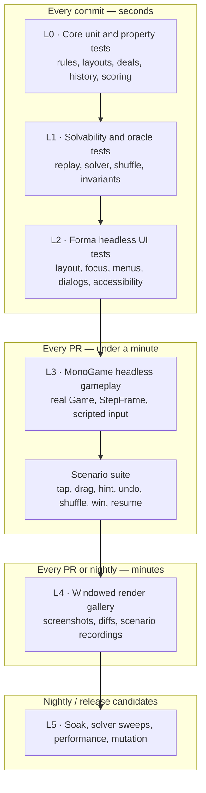
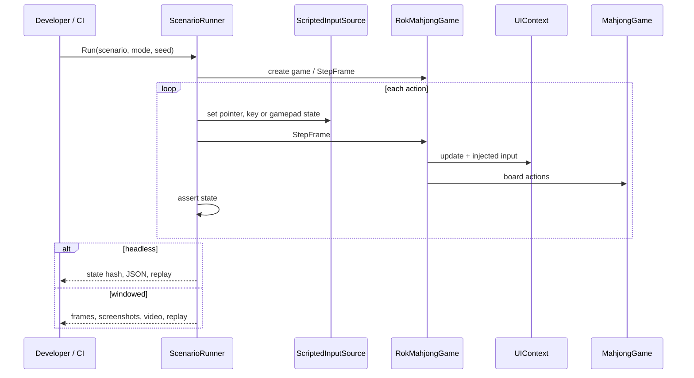
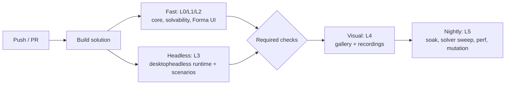
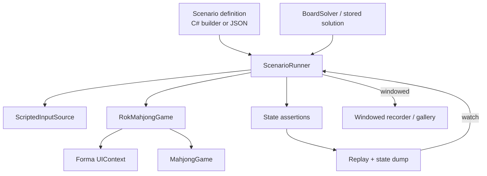

# Testing Strategy

> **Status:** planned, M0. Commands and project names in this document are the
> target shape; update them as the test projects land.

> **Desktop v1 implementation note:** v1 runs the core/solvability suites and a
> pure headless gameplay harness (`ScriptedInputSource` → `GameInputRouter` →
> `BoardController` → `MahjongGame`) plus a Forma `HeadlessInput` UI flow test.
> The native MonoGame `desktopheadless` backend and `Game.StepFrame` integration
> remain the post-v1 upgrade path described below.

Rok Mahjong treats automated gameplay testing as a first-class feature, not an
afterthought. The goal is not only “does the model compile?” but **can a player
actually complete the boards we generate, through the real input and UI path,
on every supported form factor?**

Companion documents: [plan.md](plan.md) and [architecture.md](architecture.md).

---

## 1. Goals and non-goals

### Goals

- Prove that every generated deal and every shuffle is **completable under the
  exact rules the game uses**.
- Test gameplay through the **real board, real input router and real Forma UI**,
  not by calling model methods that a player never touches.
- Catch rule regressions, input regressions, UI flow regressions, save/resume
  bugs and rendering regressions.
- Make every failure reproducible: seed, scenario, input transcript, state dump
  and replay file.
- Let a developer **watch any automated scenario** in a real window, in slow
  motion or from a replay, without maintaining a second test implementation.
- Keep the fast suite fast enough for every commit and the exhaustive suite
  practical for nightly runs.

### Non-goals

- Pixel assertions on the headless backend. It deliberately has no rasterizer;
  `GetBackBufferData` returns zeros.
- Headless performance claims. A no-op renderer cannot measure GPU cost.
- Testing third-party framework internals in this repository. Forma and MonoGame
  have their own suites.
- Replacing manual feel checks. Input comfort, animation polish and device
  ergonomics still need human playtesting.

---

## 2. Test layers



| Layer | What it proves | Runs | Can you see it? |
| --- | --- | --- | --- |
| **L0 Core unit** | Individual rules and data structures | Every commit, no GPU | No; fast feedback |
| **L1 Solvability** | Generated/shuffled boards can be cleared; deadlock/hint agree with an oracle | Every commit | State dump/replay |
| **L2 Forma headless UI** | Menus, focus, dialogs, layout and accessibility without a GPU | Every commit | UI tree/state dump |
| **L3 MonoGame headless gameplay** | The real game loop, input router, board and Forma update together | Every PR, headless backend | Replay or windowed rerun |
| **L4 Windowed visual** | Pixels, typography, layout, animation frames | PR/nightly, real backend | Screenshots, video |
| **L5 Soak/perf** | Long-run stability, solver sweeps, frame budgets | Nightly/release | Reports and recordings |

The layers are cumulative but independently runnable. A logic change should not
need a GPU; a visual change should not need the full solver sweep.

### Asset pipeline tests

`tools/tile-pipeline/tests` covers the tile art pipeline without ComfyUI or a
network:

- the 42-face catalogue is complete and unique;
- every face builds a prompt containing its own subject and the no-tile-body
  constraint;
- the Qwen-Image-Edit and Qwen-Image-Layered workflows are fully wired (every
  node reference resolves);
- the layered provider picks the transparent foreground layer, not the opaque
  background;
- the derived height field tracks the glyph alpha, and faint residual alpha is
  cleaned before the glyph is written;
- history and selection round-trip through SQLite;
- `apply` crops the tile out of its background, normalizes face art, writes the
  provenance manifest and `reset` removes it;
- the game tests assert the embedded atlas metadata covers all 42 faces and that
  the PNG dimensions match the cell grid.

Run with `make test-tiles`. Generation itself is checked manually: a generated
face must keep the glyph or pip count of `assets/art/reference/<label>.png`
before it is selected.

---

## 3. Determinism first

Every gameplay test is a deterministic scenario:

```text
scenario = layout + deck + seed + input actions + assertions
```

Rules:

- **Seeded RNG only.** No `Random.Shared`, no unseeded GUIDs, no wall clock in
  Core.
- **`Game.StepFrame(elapsed)` only.** It runs exactly one update and one draw
  with a synthetic `GameTime`; it never sleeps or catches up.
- **One input source per frame.** The scripted source feeds both the board and
  Forma injection. A test cannot pass because it bypassed the input router.
- **Fixed timestep.** Default step is `1/60 s`; scenarios can request larger
  steps for animations, but never rely on wall-clock elapsed time.
- **No sleeps.** Waits are expressed as frame counts or scenario `WaitFor`
  conditions (for example “until the win dialog is visible”).
- **State hashes.** The model exposes a stable hash of remaining tiles, faces,
  selection, score and turn state. Tests compare hashes after undo, save/load
  and replay.
- **Same scenario, two modes.** A scenario runs headless for assertions and
  windowed for observation/recording.

If a test needs the current time, it asks the scenario clock. If it needs
randomness, it asks the seeded RNG and logs the seed on failure.

---

## 4. Proving boards are playable and completable

This is the core requirement. We use several independent checks; any one alone
can miss a rule divergence.

### 4.1 Generator guarantee

The dealer works backwards:

1. every slot starts occupied;
2. pair units are assigned to two currently free slots;
3. those slots are removed;
4. repeat until empty.

The dealer stores the removal order. A **rule-agreement test** replays that order
through the real `MahjongGame` API:

```text
for each pair in stored solution order:
    assert both tiles are free in the current game
    assert the faces match
    assert MahjongGame.TryMatch succeeds
assert board is empty and result is Win
```

This catches the dangerous case where the generator and the game implement
slightly different free rules. Run it for:

- every layout family and size;
- every deck profile;
- at least **10,000 seeds** in CI, with a larger nightly sweep.

### 4.2 Shuffle guarantee

A shuffle must preserve the remaining face multiset and produce a state that is
completable from that point:

- rebuild pair units from remaining faces;
- assign them with the same backwards algorithm;
- store the shuffle’s removal order;
- replay it through the **current** game state;
- assert the board clears.

Test shuffles from:

- a fresh board;
- random mid-game states;
- states reached by deliberately poor play;
- deadlocked states.

### 4.3 Oracle solver

`RokMahjong.Core` contains a `BoardSolver` used by tests and optional auto-play:

- Depth-first search over legal pairs with a transposition table keyed by the
  canonical remaining state.
- Heuristics: prefer moves that free the most tiles, then higher layers, then
  states with more free pairs.
- A time/step budget. Results are `Solved`, `Deadlocked` or `Inconclusive`;
  tests never treat `Inconclusive` as success.

Use it for:

- all 36- and 72-tile boards;
- sampled 108/144-tile states;
- deadlock/hint agreement;
- “is this state still winnable?” regression tests.

For full 144-tile boards, the stored generator/shuffle solution is the primary
guarantee; the solver is an extra check where its budget allows.

### 4.4 Solver-driven input agent

The strongest end-to-end proof: an agent chooses moves from the verified
solution or solver, then performs them **through real input**.

```text
For each level and seed:
  launch the real game headless
  start the level
  repeat until complete:
      choose a legal pair from the solution/solver
      move the focus or pointer to the first tile
      press/activate it
      move the focus or pointer to the second tile
      press/activate it
      step frames until the match resolves
  assert board empty
  assert Result screen visible
```

The agent uses the same board actions as mouse, touch, keyboard and gamepad. A
separate scenario parameter changes the input device, so the same solve runs
through all four paths.

### 4.5 Invariants checked after every move (Debug and tests)

| Invariant | Why |
| --- | --- |
| Remaining face count is even for every match group | Prevent impossible last tiles |
| Removed tiles are recorded exactly once | History/undo correctness |
| Undo restores the exact pre-move state hash | No hidden state |
| A tile can only be removed if it was free | Rule correctness |
| Removing a tile cannot reduce the free set | Monotonic opening |
| Shuffle preserves the remaining multiset | No cheating |
| Hint returns a legal matching pair, or none in deadlock | Hint correctness |
| Deadlock detector agrees with legal-pair enumeration | Prompt correctness |
| Save/load round-trips the state hash | Resume correctness |
| Score/combo changes only on committed moves | UI and rules agree |

In Debug builds these are hard assertions. In Release they are compiled out of
the hot path; tests still check them explicitly.

### 4.6 Property-based tests

Use **CsCheck** (runner-agnostic) alongside xUnit. Generate random:

- layouts and coordinate sets;
- face multisets;
- move sequences and undo/redo sequences;
- save/load points;
- viewport sizes and orientations;
- input device sequences.

Properties:

- `IsFree` matches a reference implementation on random boards.
- Any sequence of legal removals leaves even face counts.
- Undo after any move restores the state hash.
- Two shuffles of the same multiset preserve counts.
- A generated deal’s stored solution always clears through the game API.
- Save/load at any move preserves state and future solution.
- Fitting a board never produces a tile larger than the available rect or
  smaller than the minimum without emitting a prompt.

### 4.7 Mutation testing (nightly, optional but recommended)

Run Stryker.NET on `RokMahjong.Core` for the free rule, deal generator, shuffle,
history and scoring. The goal is not a score for its own sake; it proves the
tests fail when a rule is deliberately broken. Start with the critical rule
files, not the whole solution.

### 4.8 Regression corpus

Every gameplay bug gets:

1. a failing scenario;
2. the seed and input transcript;
3. the fix;
4. the scenario kept forever.

The scenario file and replay are the bug report. No “works on my machine”
without a replay.

---

## 5. Headless gameplay harness

### 5.1 Backend

The MonoGame fork provides a **headless graphics backend**:

- full `Game` lifecycle, update and draw;
- real `SpriteBatch`, textures, render targets and stock effects;
- no rasterization, no shader execution;
- `GetBackBufferData` returns zeros by design;
- selected through `MonoGame.Framework.Native` plus the `desktopheadless`
  `libmgruntime`;
- `SDL_VIDEODRIVER=dummy` and `SDL_AUDIODRIVER=dummy` must be in the **process
  environment before startup**.

`Game.StepFrame(TimeSpan? elapsed)` runs exactly one update and one draw with a
synthetic clock. It is the only frame driver used by headless tests and
Playtest.

### 5.2 Project and build shape

```text
src/MonoGame.Backend.props
    Backend=DesktopGL      -> normal desktop build
    Backend=DesktopNative  -> optional Metal/Vulkan
    Backend=Headless       -> MonoGame.Framework.Native + desktopheadless
                              defines ROK_HEADLESS, copies the runtime
tests/RokMahjong.Game.Tests
    references RokMahjong.TestHarness, Forma.Testing
    builds with Backend=Headless in the headless job
tools/RokMahjong.Playtest
    builds with Backend=Headless or a real backend
```

Planned commands:

```bash
# One-time native prerequisites for the headless runtime.
git -C third_party/MonoGame submodule update --init \
  native/monogame/external/sdl3 \
  native/monogame/external/faudio

# macOS arm64 example (see MonoGame HEADLESS.md for Linux).
make headless-runtime

# Fast non-visual suites.
make test              # L0/L1/L2
make test-headless     # L3 + scenarios on the headless backend
make test-all          # all non-visual suites
```

The headless job sets the environment at the job level, not inside a test:

```yaml
env:
  SDL_VIDEODRIVER: dummy
  SDL_AUDIODRIVER: dummy
```

A `headless.runsettings` file provides the same values for IDEs.

### 5.3 Fixture shape

One real game per process, serialized because Forma’s text layout uses
process-wide static caches:

```csharp
[CollectionDefinition("headless-game", DisableParallelization = true)]
public sealed class HeadlessGameCollection : ICollectionFixture<HeadlessGameFixture>;

public sealed class HeadlessGameFixture : IDisposable
{
    public HeadlessGameFixture()
    {
        Game = new RokMahjongGame(deterministicSettings: true, headlessTest: true);
        Game.InputSource = new ScriptedInputSource();
        Step(3);
    }

    public void Step(int frames = 1) { for (var i = 0; i < frames; i++) Game.StepFrame(); }
}
```

The fixture provides:

- `Click`, `Tap`, `Drag`, `Key`, `Gamepad`, `Resize`, `WaitFor`;
- `State()` returning a serializable game/UI snapshot;
- `Bounds(automationId)` and `Center(automationId)`;
- `AttachStateIfFailed()` for diagnostics;
- `Dispose()` that shuts the game down cleanly.

### 5.4 Content and fonts without a GPU

- UI fonts are embedded; FreeType/HarfBuzz rasterize on the CPU.
- The board uses a placeholder atlas in headless tests; no content build is
  required for gameplay assertions.
- Audio is disabled by `deterministicSettings`.
- Save data goes to a per-test temporary directory.
- Anything that reads pixels is forbidden in headless tests.

### 5.5 What headless cannot do

| Works headless | Requires a real backend |
| --- | --- |
| Game lifecycle, update/draw calls | Pixels, colors, text sharpness |
| SpriteBatch passes, render targets | GPU performance and driver behavior |
| Texture set/get round trips | Screenshots and video |
| Forma layout, focus, input, hit testing | Visual regression baselines |
| Model and UI state assertions | Animation “feel” |

If a scenario needs pixels, it belongs in L4 and runs windowed.

---

## 6. Seeing a test

Tests are not a black box. The same scenario can be executed in four ways:

```bash
# Headless, assert and print JSON.
dotnet run --project tools/RokMahjong.Playtest -- \
  --scenario solve-pagoda --seed 1234 --mode headless --json

# Real window, normal speed.
dotnet run --project tools/RokMahjong.Playtest -- \
  --scenario solve-pagoda --seed 1234 --mode windowed

# Slow motion with the debug scenario overlay.
dotnet run --project tools/RokMahjong.Playtest -- \
  --scenario solve-pagoda --seed 1234 --mode windowed --speed 0.25 --overlay

# Replay a recorded failure.
dotnet run --project tools/RokMahjong.Playtest -- \
  --replay artifacts/replays/bug-123.json --mode windowed
```

### Debug overlay in windowed mode

- Scenario name, seed, step index, current action.
- Input device and last action.
- Remaining tiles and free-tile count.
- Model state hash.
- Next assertion and its status.
- Frame time and total scenario time.

### Recording

Windowed Playtest can record:

- PNG frame sequences for deterministic inspection;
- MP4/GIF via ffmpeg for sharing;
- the replay JSON containing seed, layout, deck, actions and assertions.

Headless runs still write the replay and state dump; only pixels are missing.
A failing CI job uploads the replay so any developer can watch the same failure
locally.



---

## 7. Scenario model

Scenarios are data, not bespoke test code. A C# fluent builder is used inside
tests; the same model serializes to JSON for Playtest and replays.

### Actions

- `StartLevel(layoutId, deckId, seed)`
- `ClickTile(tileId or coord)`
- `TapTile`, `DragTile(from, to)`
- `FocusNext(direction)`, `ActivateFocus`, `Cancel`
- `UseHint`, `Shuffle`, `Undo`, `Restart`, `Pause`, `Resume`
- `SwitchInput(mouse|touch|keyboard|gamepad)`
- `Resize(width, height)`, `Rotate`
- `WaitFrames(n)`, `WaitFor(predicate, timeout)`
- `Save`, `Reload`, `QuitToMenu`, `Continue`
- `SolveWithOracle` / `PlaySessionSolution`

### Assertions

- `TileCount`, `FreeTileSet`, `Selection`, `Score`, `Combo`
- `Result` (`Playing`, `Won`, `Deadlocked`, `Paused`)
- `ControlVisible(automationId)`, `ControlText`, `Focus`
- `StateHash(expected)`
- `NoExceptions`, `NoDebugAssertions`

### Example

```json
{
  "name": "match-first-free-pair",
  "layout": "lotus-36",
  "deck": "mini36",
  "seed": 1234,
  "steps": [
    { "action": "startLevel" },
    { "action": "clickTile", "near": "firstFreeTile" },
    { "action": "clickTile", "near": "matchingFreeTile" },
    { "action": "waitFor", "result": "matchedPair" },
    { "action": "assert", "tiles": 34 },
    { "action": "assert", "score": "> 0" }
  ]
}
```

Scenario failures print the state block and write:

```text
artifacts/test-failures/<scenario>-<seed>/
  replay.json
  state.json
  game.log
  ui-tree.txt
  screenshot.png      # windowed only
  frames/             # optional
```

---

## 8. Visual regression and gallery

Headless cannot see pixels, so visual testing is a separate windowed layer.

- A real graphics backend renders deterministic scenes.
- Fixed seed, fixed settings, fixed UI scale, fixed fonts.
- One scene per important state:
  - main menu;
  - level select;
  - gameplay portrait;
  - gameplay landscape;
  - pause;
  - settings;
  - how to play;
  - win;
  - deadlock.
- Viewports: phone portrait/landscape, tablet, 1280×720, 1920×1080, 2× scale.
- Baselines are checked in; diffs are written to `artifacts/gallery/diff`.
- `make gallery` renders all scenes; `make gallery-changed` renders only scenes
  whose sources changed; `make gallery-update` accepts new baselines after
  review.
- Animations are covered by short recorded sequences, not single screenshots.
- Text/locale clipping is checked with the longest strings and future locales.

Visual tests answer “does it look right?”. Gameplay tests answer “does it play
right?”. Neither replaces the other.

---

## 9. CI and quality gates



### Jobs

| Job | Trigger | Contents | Budget |
| --- | --- | --- | --- |
| **Build** | every push/PR | restore, build, analyzers | < 5 min |
| **Fast tests** | every push/PR | Core unit/property, layout validation, Forma headless UI | < 2 min |
| **Headless gameplay** | every push/PR | MonoGame headless runtime + scenario suite | < 10 min |
| **Visual** | PR (macOS/Linux) + nightly | gallery screenshots, selected recordings | < 15 min |
| **Nightly** | schedule/manual | 10k deal sweep, solver states, soak, mutation, performance trend | longer |

### Caching

- Cache the `desktopheadless` runtime keyed by:
  MonoGame commit + `premake5.lua` + headless native sources + SDL3/FAudio
  commits + OS/arch.
- Cache NuGet packages and the content build.
- Never cache test state or save files.

### Artifacts

Every failed job uploads:

- TRX/test results;
- replay JSON and state dump;
- UI tree at failure;
- screenshots/frames for windowed failures;
- performance reports for nightly runs.

### Coverage and quality targets

- `RokMahjong.Core`: ≥ 95% line coverage; 100% branch coverage on
  `FreeRule`, `DealGenerator`, `ShuffleService` and `HistoryStack`.
- Every new layout/deck: solvability suite included.
- Every new input modality: at least one scenario through that device.
- Every new screen: headless UI test + gallery scene.
- Every fixed gameplay bug: regression scenario + replay.
- No retries to hide flakiness. Quarantine, reproduce with the replay, fix.

### Flaky-test policy

- Deterministic seeds and `StepFrame` remove most timing flakiness.
- Headless gameplay tests run in a non-parallel collection because Forma has
  process-wide text caches.
- A flaky test is a bug. Do not merge a “retry twice” workaround.
- If a scenario is inherently timing-sensitive in windowed mode, keep the
  assertion in headless and use the windowed version for observation only.

---

## 10. Test data

Checked-in corpora keep tests reproducible and reviewable:

```text
tests/Data/
  layouts/            # every layout definition + validation metadata
  decks/              # deck profiles and expected counts
  seeds/
    smoke.txt         # fast seed set
    nightly.txt       # exhaustive seed set
  scenarios/
    gameplay/         # release-blocking scenarios
    regression/       # one file per fixed bug
  gallery/
    manifest.json     # scene, viewport, scale, seed, actions
```

- Generated data is checked in with the generator command and seed in a comment
  or sidecar file.
- Tests never depend on the developer’s local save files or clock.
- Daily-challenge seeds are derived from a date and tested against a known
  reference.

---

## 11. Definition of done for gameplay work

A gameplay change is not done until:

- [ ] Core unit/property tests cover the new rule path.
- [ ] A generated-deal replay test still clears through the real game API.
- [ ] A headless scenario exercises the change through the real input path.
- [ ] Mouse, touch, keyboard and gamepad paths are covered where the change
      affects input.
- [ ] Portrait and landscape layouts are exercised.
- [ ] Save/resume still round-trips the state hash.
- [ ] A replay is attached for any bug fix.
- [ ] The visual gallery has only intended changes (if UI changed).
- [ ] `make check-submodules` passes.

---

## 12. Known risks and mitigations

| Risk | Mitigation |
| --- | --- |
| Headless native runtime is expensive to build | Cache by MonoGame/native commit; build only in the headless job; keep fast tests GPU-free |
| SDL dummy drivers not set early enough | Set in job/`runsettings` process environment, never inside a test |
| Forma static caches race parallel tests | Non-parallel headless collection; one game per process |
| Headless cannot validate pixels | Separate L4 gallery with a real backend; recordings for animation |
| Solver too slow on 144 tiles | Stored generator/shuffle solutions for full boards; oracle on smaller boards and sampled states with a budget |
| Scenario DSL becomes a second game API | The DSL only emits input actions and assertions; it never mutates `MahjongGame` directly |
| Visual baselines are flaky across GPUs | Fixed backend/OS for baselines; diff thresholds; baselines reviewed on the same runner image |
| Tests become slow | Layer budgets; fast suite every commit, exhaustive nightly; no sleeps |
| Content/fonts missing headless | Embedded fonts, placeholder atlas, audio disabled, no readback |

---

## 13. Test architecture summary



The same scenario definition drives unit-level checks, headless gameplay,
windowed observation, recordings and regression replays. That single source is
the key practice: **if you can assert it, you can watch it; if you can watch it,
you can reproduce it.**
